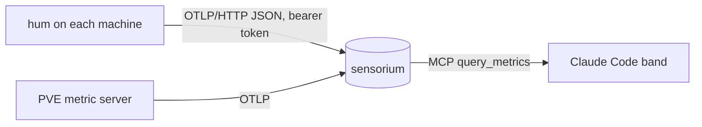

<div align="center">

<h1>hum</h1>

<p><strong>Host metrics from a 7 MB agent over OTLP, shown above your Claude Code prompt.</strong></p>

[](https://github.com/zyx1121/hum/actions)
[](https://github.com/zyx1121/hum/releases)
[](LICENSE)

**English** | [繁體中文](README.zh-TW.md) | [简体中文](README.zh-CN.md)

</div>

```
 💻 cpu mem disk gpu  ● spawner 1% 73% 67% –  ● carrel01 1% 4% 14% –  ● furnace 4% 36% 87% 3%  ● laptop 4% 64% 13% 0%  ● macmini 2% 76% 98% 0%
```

Checking a few machines used to mean an ssh round each, or a Prometheus stack that you never had time to build. hum is one binary per machine that reports to any OpenTelemetry endpoint, and a Claude Code band that shows every machine in one line.

## Features

- **Reports host metrics**: CPU, memory, every fixed disk, network bytes, uptime and GPU load every 15 seconds, as OTLP/HTTP JSON.
- **Stays small**: one static binary (7 MB on disk, 17 MB resident) for Linux, Windows and macOS, with no SDK and no config file.
- **Runs where binaries cannot**: with Windows Smart App Control on, the installer uses `hum.ps1` instead, which sends the same metrics.
- **Shows them in Claude Code**: the `hum` plugin draws one line above the prompt, offline machines in red.

## Quick start

```sh
curl -fsSL -o hum https://github.com/zyx1121/hum/releases/latest/download/hum-darwin-arm64
chmod +x hum && ./hum -once
```

You should see one OTLP JSON payload with this machine's metrics. In this mode, hum sends nothing. Builds for Linux, Windows and Intel Macs are on [Releases](https://github.com/zyx1121/hum/releases).

## Usage

1. Create an ingest token on your OTLP backend. With [sensorium](https://github.com/zyx1121/sensorium): `docker compose run --rm ingest register-project devices`.
2. Install the agent on each machine with that token and `-endpoint https://<backend>/v1/metrics`:

   | OS | Runs as | How |
   |----|---------|-----|
   | Linux | systemd service | copy [deploy/hum.service](deploy/hum.service) to `/etc/systemd/system/`, put the token in `/etc/hum/token`, `systemctl enable --now hum` |
   | macOS | `launchd` agent | copy [deploy/tw.zyx.hum.plist](deploy/tw.zyx.hum.plist) to `~/Library/LaunchAgents/`, replace the placeholders, `launchctl bootstrap gui/$(id -u) <plist>` |
   | Windows | service, or a startup task under Smart App Control | put `hum.exe`, `hum.ps1` and a `token` file next to [deploy/install-windows.ps1](deploy/install-windows.ps1) and run it as Administrator |

3. Add the band to Claude Code:

   ```sh
   /plugin marketplace add zyx1121/hum
   /plugin install hum@hum
   ```

   It reads sensorium's MCP endpoint with the token in `SENSORIUM_ZYX_TOKEN` and needs `CLAUDE_CODE_ENABLE_FUNCTION_HOOKS=1`.

> [!IMPORTANT]
> The token file is the only secret. The Windows installer limits it to SYSTEM and Administrators. The systemd unit gives it to a dynamic user as a credential.

Proxmox VE 9.1 and later can skip the agent: its built-in OpenTelemetry metric server reports the node and every guest.

## Configuration

| Flag | Env | Sets | Default |
|------|-----|------|---------|
| `-endpoint` | `HUM_ENDPOINT` | OTLP/HTTP metrics URL | required |
| `-token-file` | `HUM_TOKEN_FILE` | file holding the bearer token | none |
| `-host` | `HUM_HOST` | `host.name` to report | OS hostname, lowercased |
| `-interval` | | time between reports | `15s` |
| `-once` | | print one payload and exit | off |

## How it works



Each tick, hum reads the host through [gopsutil](https://github.com/shirou/gopsutil) and posts one export request using OpenTelemetry semantic-convention names. Every point carries `host.name`, so a backend that drops the resource can still identify each machine. The agent holds only an ingest token, which can write metrics and read nothing.

## For AI agents

Structured facts for coding agents and LLM tools.

```yaml
name: hum
summary: Host metrics agent posting OTLP/HTTP JSON every 15 s, plus a Claude Code band that reads them back through sensorium's MCP endpoint.
type: cli
interfaces:
  cli: hum
  mcp: none (the band is an MCP client of sensorium's query_metrics)
  http: none (hum is a client of an OTLP/HTTP endpoint)
install: download hum-<os>-<arch> from https://github.com/zyx1121/hum/releases/latest
run: hum -endpoint https://<backend>/v1/metrics -token-file <path>
verify: hum -once
config: [HUM_ENDPOINT, HUM_TOKEN_FILE, HUM_HOST, SENSORIUM_ZYX_TOKEN]
secrets: [ingest token in the file given to -token-file, SENSORIUM_ZYX_TOKEN for the band]
limits: [no buffering, a failed post is dropped and the next tick retries, the band's machine list is hard-coded in plugin/hooks/register.tsx]
```

## Development

```sh
git clone https://github.com/zyx1121/hum && cd hum
go test ./... && go build -o hum .
CLAUDE_CODE_ENABLE_FUNCTION_HOOKS=1 claude plugin test plugin
```

CI runs `go vet` for Linux and Windows, `go test`, and builds all five targets. A `v*` tag publishes them as a release.

## License

[MIT](LICENSE)
