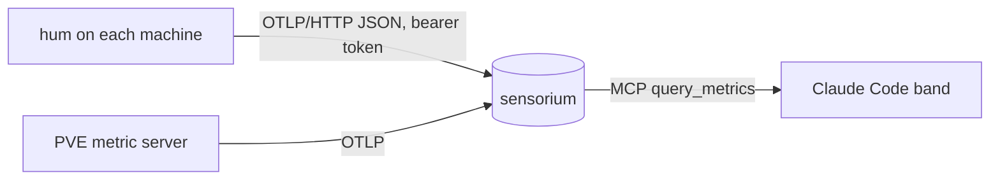

<!-- 翻译自 README.md @ docs/readme-v2。只翻译 "For AI agents" 之前的章节，英文版更新时一起改。 -->

<div align="center">

<h1>hum</h1>

<p><strong>7 MB 的 agent 通过 OTLP 上报主机指标，直接显示在 Claude Code 提示栏上方。</strong></p>

[](https://github.com/zyx1121/hum/actions)
[](https://github.com/zyx1121/hum/releases)
[](LICENSE)

[English](README.md) | [繁體中文](README.zh-TW.md) | **简体中文**

</div>

```
╭─ SPAWNER ──────────────────╮╭─ FURNACE ─────────────────────────╮╭─ CARREL01 ─────────────────╮
│ CPU 1%  MEM 73%  DSK 67%   ││ CPU 4%  MEM 36%  DSK 87%  GPU 3%  ││ CPU 1%  MEM 4%  DSK 14%    │
╰──────────────────── 28K/s ─╯╰─────────────────────────── 12K/s ─╯╰──────────────────── 25K/s ─╯
```

以前要看几台机器的状态，得一台一台 ssh 进去，不然就是搭一整套一直没空弄的 Prometheus。hum 是每台机器一个可执行文件，把指标发到任何 OpenTelemetry 端点，再由 Claude Code 状态栏把所有机器显示在同一行。

## 功能

- **上报主机指标**：每 15 秒发送 CPU、内存、每块固定磁盘、网络流量、运行时间与 GPU 负载，格式是 OTLP/HTTP JSON。
- **体积小**：Linux、Windows、macOS 各一个静态可执行文件(磁盘 7 MB、常驻 17 MB)，不需要 SDK，也不需要配置文件。
- **可执行文件被拦也能跑**：Windows 开启 Smart App Control 时，安装程序会改用 `hum.ps1`，发送相同的指标。
- **显示在 Claude Code**：`hum` 插件在提示栏上方画一行，离线的机器标红色。

## 快速开始

```sh
curl -fsSL -o hum https://github.com/zyx1121/hum/releases/latest/download/hum-darwin-arm64
chmod +x hum && ./hum -once
```

应该会看到一份这台机器的 OTLP JSON，不会发送任何数据。Linux、Windows 和 Intel Mac 的版本在 [Releases](https://github.com/zyx1121/hum/releases)。

## 使用方法

1. 在 OTLP 后端创建写入令牌。使用 [sensorium](https://github.com/zyx1121/sensorium) 的话：`docker compose run --rm ingest register-project devices`。
2. 在每台机器安装 agent，带上令牌和 `-endpoint https://<backend>/v1/metrics`：

   | 系统 | 运行方式 | 步骤 |
   |------|----------|------|
   | Linux | systemd 服务 | 把 [deploy/hum.service](deploy/hum.service) 复制到 `/etc/systemd/system/`，令牌放在 `/etc/hum/token`，执行 `systemctl enable --now hum` |
   | macOS | `launchd` agent | 把 [deploy/tw.zyx.hum.plist](deploy/tw.zyx.hum.plist) 复制到 `~/Library/LaunchAgents/`，填好占位值，执行 `launchctl bootstrap gui/$(id -u) <plist>` |
   | Windows | 服务，Smart App Control 开启时改用开机计划任务 | 把 `hum.exe`、`hum.ps1` 和 `token` 文件放在 [deploy/install-windows.ps1](deploy/install-windows.ps1) 旁边，以管理员身份运行 |

3. 在 Claude Code 加上状态栏：

   ```sh
   /plugin marketplace add zyx1121/hum
   /plugin install hum@hum
   ```

   它用 `SENSORIUM_ZYX_TOKEN` 里的令牌读取 sensorium 的 MCP 端点，需要设置 `CLAUDE_CODE_ENABLE_FUNCTION_HOOKS=1`。

> [!IMPORTANT]
> 令牌文件是唯一的机密。Windows 安装程序只允许 SYSTEM 和 Administrators 读取。systemd unit 通过 credential 交给动态用户。

Proxmox VE 9.1 及以后可以不装 agent：内置的 OpenTelemetry 指标服务器会上报节点和所有 guest。

PVE 指标服务器不发送温度。[`deploy/temp-watch`](deploy/temp-watch) 补上温度：每 60 秒读取 CPU、NVMe、SATA 硬盘的传感器，用同一个端点和 token 发送 `hw.temperature`。

[`deploy/disk-watch`](deploy/disk-watch) 每 10 分钟报告存储健康：ZFS pool 状态、用量、距上次 scrub 的天数，每块硬盘的 SMART 结果与坏道数，以及每台 guest 最新一份 Proxmox Backup Server 备份的时间。每个问题也会发送一条 WARN log。

## 配置

| 参数 | 环境变量 | 作用 | 默认值 |
|------|----------|------|--------|
| `-endpoint` | `HUM_ENDPOINT` | OTLP/HTTP 指标地址 | 必填 |
| `-token-file` | `HUM_TOKEN_FILE` | 存放 bearer 令牌的文件 | 无 |
| `-host` | `HUM_HOST` | 上报的 `host.name` | 系统主机名(小写) |
| `-interval` | | 上报间隔 | `15s` |
| `-once` | | 打印一份数据后退出 | 关 |

## 工作原理



hum 每次通过 [gopsutil](https://github.com/shirou/gopsutil) 读取主机状态，用 OpenTelemetry 语义约定的名称发送一次导出请求。每个数据点都带 `host.name`，即使后端丢掉 resource 也能区分是哪台机器。agent 只持有写入令牌，只能写指标，什么都读不到。

## 其他

给 AI agent 的结构化信息与开发说明见[英文版](README.md#for-ai-agents)。

## 许可证

[MIT](LICENSE)
