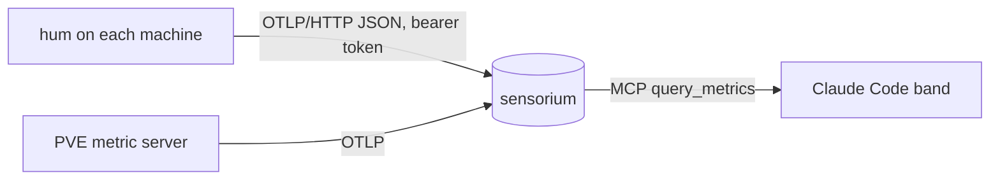

<!-- 翻譯自 README.md @ docs/readme-v2。只翻 "For AI agents" 以上的章節；英文版更新時一起改。 -->

<div align="center">

<h1>hum</h1>

<p><strong>7 MB 的 agent 透過 OTLP 回報主機指標，直接顯示在 Claude Code 提示列上方。</strong></p>

[](https://github.com/zyx1121/hum/actions)
[](https://github.com/zyx1121/hum/releases)
[](LICENSE)

[English](README.md) | **繁體中文** | [简体中文](README.zh-CN.md)

</div>

```
 💻 cpu mem disk gpu  ● spawner 1% 73% 67% –  ● carrel01 1% 4% 14% –  ● furnace 4% 36% 87% 3%  ● laptop 4% 64% 13% 0%  ● macmini 2% 76% 98% 0%
```

以前要看幾台機器的狀態，得一台一台 ssh 進去，不然就是架一整套一直沒空弄的 Prometheus。hum 是每台機器一個執行檔，把指標送到任何 OpenTelemetry 端點，再由 Claude Code 狀態列把所有機器顯示在同一行。

## 功能

- **回報主機指標**：每 15 秒送出 CPU、記憶體、每顆固定磁碟、網路流量、開機時間與 GPU 負載，格式是 OTLP/HTTP JSON。
- **體積小**：Linux、Windows、macOS 各一個靜態執行檔(磁碟 7 MB、常駐 17 MB)，不用 SDK，也不用設定檔。
- **執行檔被擋也能跑**：Windows 開著 Smart App Control 時，安裝程式會改用 `hum.ps1`，送出相同的指標。
- **顯示在 Claude Code**：`hum` plugin 在提示列上方畫一行，離線的機器標紅色。

## 快速開始

```sh
curl -fsSL -o hum https://github.com/zyx1121/hum/releases/latest/download/hum-darwin-arm64
chmod +x hum && ./hum -once
```

應該會看到一份這台機器的 OTLP JSON，不會送出任何資料。Linux、Windows 和 Intel Mac 的版本在 [Releases](https://github.com/zyx1121/hum/releases)。

## 使用方式

1. 在 OTLP 後端建立寫入權杖。用 [sensorium](https://github.com/zyx1121/sensorium) 的話：`docker compose run --rm ingest register-project devices`。
2. 在每台機器安裝 agent，帶上權杖和 `-endpoint https://<backend>/v1/metrics`：

   | 系統 | 執行方式 | 步驟 |
   |------|----------|------|
   | Linux | systemd 服務 | 把 [deploy/hum.service](deploy/hum.service) 複製到 `/etc/systemd/system/`，權杖放在 `/etc/hum/token`，執行 `systemctl enable --now hum` |
   | macOS | launchd agent | 把 [deploy/tw.zyx.hum.plist](deploy/tw.zyx.hum.plist) 複製到 `~/Library/LaunchAgents/`，填好佔位值，執行 `launchctl bootstrap gui/$(id -u) <plist>` |
   | Windows | 服務，Smart App Control 開啟時改用開機排程 | 把 `hum.exe`、`hum.ps1` 和 `token` 檔放在 [deploy/install-windows.ps1](deploy/install-windows.ps1) 旁邊，用系統管理員執行 |

3. 在 Claude Code 加上狀態列：

   ```sh
   /plugin marketplace add zyx1121/hum
   /plugin install hum@hum
   ```

   它用 `SENSORIUM_ZYX_TOKEN` 裡的權杖讀 sensorium 的 MCP 端點，需要設 `CLAUDE_CODE_ENABLE_FUNCTION_HOOKS=1`。

> [!IMPORTANT]
> 權杖檔是唯一的機密。Windows 安裝程式只讓 SYSTEM 和 Administrators 讀取；systemd unit 用 credential 交給動態使用者。

Proxmox VE 9.1 以後可以不裝 agent：內建的 OpenTelemetry 指標伺服器會回報節點和所有 guest。

## 設定

| 參數 | 環境變數 | 作用 | 預設 |
|------|----------|------|------|
| `-endpoint` | `HUM_ENDPOINT` | OTLP/HTTP 指標網址 | 必填 |
| `-token-file` | `HUM_TOKEN_FILE` | 存放 bearer 權杖的檔案 | 無 |
| `-host` | `HUM_HOST` | 回報的 `host.name` | 系統主機名稱(小寫) |
| `-interval` | | 回報間隔 | `15s` |
| `-once` | | 印出一份資料後結束 | 關 |

## 運作方式



hum 每次透過 [gopsutil](https://github.com/shirou/gopsutil) 讀取主機狀態，用 OpenTelemetry 語意慣例的名稱送出一次匯出請求。每個資料點都帶 `host.name`，就算後端丟掉 resource 也分得出是哪台機器。agent 只持有寫入權杖，只能寫指標，什麼都讀不到。

## 其他

給 AI agent 的結構化資訊與開發說明在[英文版](README.md#for-ai-agents)。

## 授權

[MIT](LICENSE)
